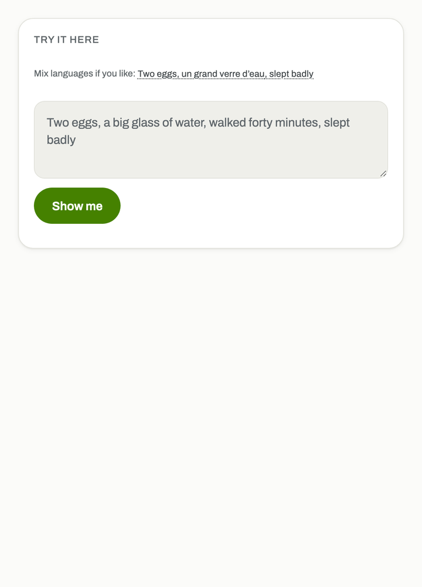
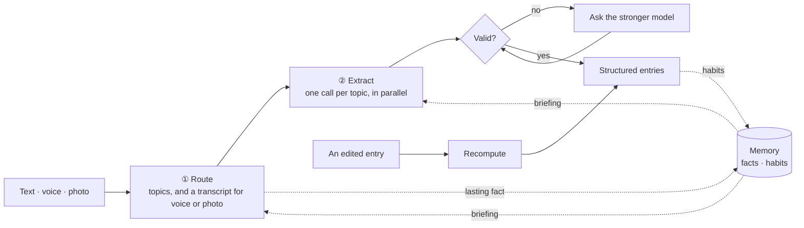

# farkad-ai

[](https://github.com/brmel/farkad-ai/actions/workflows/ci.yml)
[](LICENSE)

The AI engine behind [Farkad](https://farkad.web.app). You say what you ate and did, in your own
words and languages, and it becomes structured health entries. I build it in the open to learn
applied AI on a real product.

<p align="center">
  <picture>
    <source media="(prefers-color-scheme: dark)" srcset="docs/demo/dark.gif">
    
  </picture>
  <br>
  <sub>Recorded from the <a href="https://farkad.web.app/try">live demo</a>, which runs this engine.</sub>
</p>

## How it works



The vendor sits behind the `Model` interface and the pipeline behind `CaptureEngine`, so either
can be replaced without touching the other.

## How well it works

Fifteen examples, three per language, recorded on `gemini-3.5-flash-lite` on 2026-11-09:

| Language | Routing | Fields | Validators | Tokens (in / out) |
| --- | --: | --: | --: | --: |
| English | 100% | 100% | 100% | 2,628 / 193 |
| French | 100% | 100% | 100% | 2,466 / 173 |
| Arabic | 100% | 100% | 100% | 1,927 / 94 |
| Spanish | 100% | 100% | 100% | 2,288 / 150 |
| Mixed languages | 100% | 100% | 100% | 2,689 / 170 |

A small set: read it as a regression check, not a benchmark.

## Done

- [x] Text, [voice](https://ai.google.dev/gemini-api/docs/audio) and [photo](https://ai.google.dev/gemini-api/docs/image-understanding) input
- [x] English, French, Arabic with Darija, and Spanish, mixed in one breath
- [x] [Structured output](https://ai.google.dev/gemini-api/docs/structured-output), validated with [Pydantic](https://docs.pydantic.dev)
- [x] [Model cascade](https://arxiv.org/abs/2305.05176)
- [x] [Reasoning budget](https://ai.google.dev/gemini-api/docs/thinking) per tier
- [x] [Few-shot examples](https://arxiv.org/abs/2005.14165) per topic
- [x] Long-term memory: facts and habits
- [x] Recompute on edit
- [x] [Implicit caching](https://ai.google.dev/gemini-api/docs/caching)
- [x] Evaluation on a gold set of recorded answers

## Not done yet

- [ ] [Decisions API](https://blog.google/innovation-and-ai/technology/developers-tools/gemini-decisions-api/), once it reaches Vertex AI
- [ ] [Tool calling](https://ai.google.dev/gemini-api/docs/function-calling)
- [ ] Nutrition values from a food database, such as [Open Food Facts](https://world.openfoodfacts.org)
- [ ] [Video input](https://ai.google.dev/gemini-api/docs/video-understanding)
- [ ] [Audio output](https://ai.google.dev/gemini-api/docs/speech-generation)
- [ ] [Live voice](https://ai.google.dev/gemini-api/docs/live)
- [ ] Food recommendations
- [ ] Weekly summaries in plain words
- [ ] Diary search by meaning, with [embeddings](https://ai.google.dev/gemini-api/docs/embeddings)
- [ ] On-device models
- [ ] [Batch](https://ai.google.dev/gemini-api/docs/batch-api) evaluation runs

Left out on purpose: [RAG](https://arxiv.org/abs/2005.11401), because a person's memory fits in
the prompt; fine-tuning, because prompts and the gold set iterate faster; and
[agents](https://www.anthropic.com/research/building-effective-agents), because a fixed pipeline
is cheaper and reproducible.

## Try it

You can reproduce the table, or route one of its examples, with no API key:

```bash
pip install "farkad-ai @ git+https://github.com/brmel/farkad-ai"
farkad-ai eval
farkad-ai route --text "I drank 500 ml of water"
```

Your own input needs a live model: install `farkad-ai[google]` and pass `--provider vertex`.

## Extend it

- **A topic:** copy one of the seven in `farkad_ai/eval/pillars.py` and add examples to
  `farkad_ai/eval/example_gold.json`.
- **A model provider:** add one module beside `farkad_ai/models/vertex.py`.
- **A prompt:** add a text file in `farkad_ai/prompts/assets/`.

[Contributing](CONTRIBUTING.md) says what each one needs · [Changelog](CHANGELOG.md) ·
[Security](SECURITY.md) · [Apache 2.0](LICENSE)
