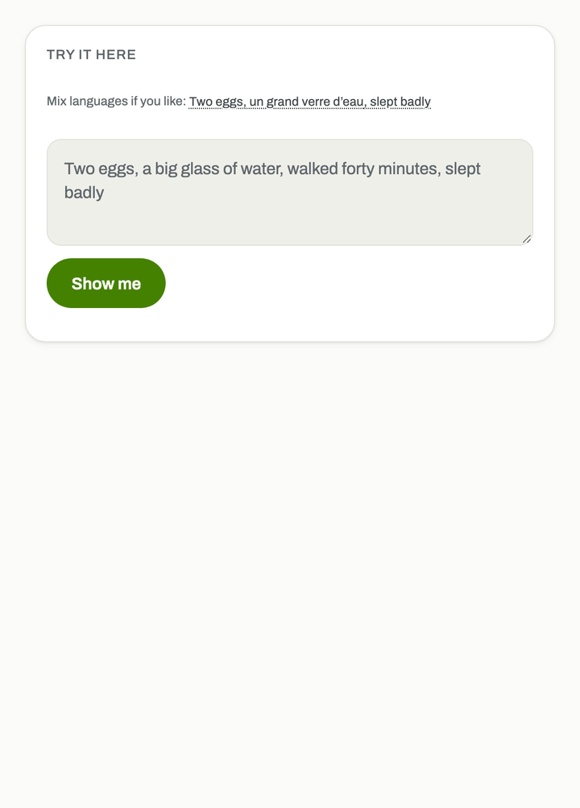
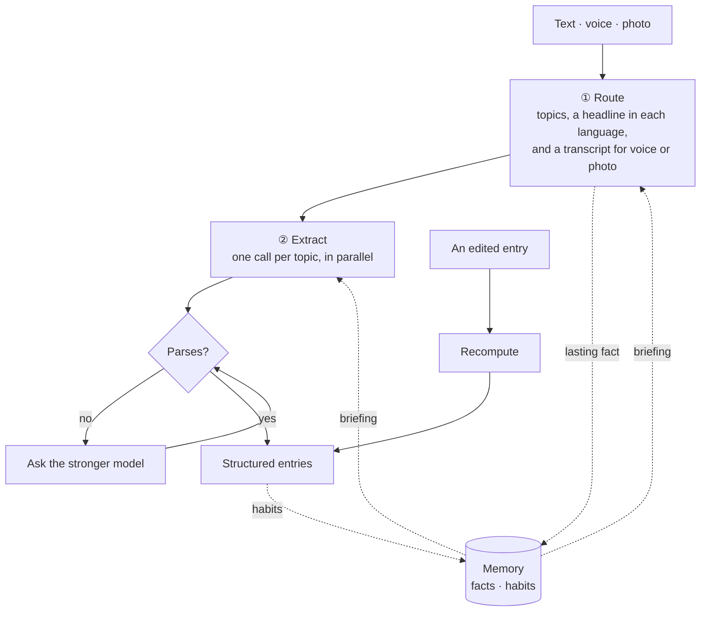

# farkad-ai

[](https://github.com/brmel/farkad-ai/actions/workflows/ci.yml)
[](LICENSE)

The AI engine behind [Farkad](https://farkad.web.app). You say what you ate and did, in your own
words and languages, and it becomes structured health entries. It is developed in the open, and
is pre-1.0: a minor version may break the API, as the [changelog](CHANGELOG.md) marks.

<p align="center">
  <picture>
    <source media="(prefers-color-scheme: dark)" srcset="docs/demo/dark.gif">
    
  </picture>
  <br>
  <sub>Recorded from the <a href="https://farkad.web.app/try">live demo</a>, which runs this engine.</sub>
</p>

## Try it

No API key: the engine below answers from recorded Gemini responses.

```python
import asyncio

from farkad_ai.eval.example import HEADLINE_LANGUAGES, RECORDINGS
from farkad_ai.eval.pillars import EXAMPLE_PILLARS
from farkad_ai.models.recorded import RecordedModel
from farkad_ai.pipeline.engine import TwoPassCaptureEngine
from farkad_ai.pipeline.port import CaptureRequest

engine = TwoPassCaptureEngine(
    RecordedModel(RECORDINGS), EXAMPLE_PILLARS, headline_languages=HEADLINE_LANGUAGES
)
request = CaptureRequest(tracked=EXAMPLE_PILLARS, text="I drank 500 ml of water")
print(asyncio.run(engine.capture(request)))
```

It prints a `Logged` holding one water entry, `{'category': 'water', 'volume_ml': 500.0}`, and
the token usage of the two calls. It needs Python 3.13 or later and is not on PyPI: install it
from GitHub, then reproduce the figures below or route a sentence from the command line:

```bash
pip install "farkad-ai @ git+https://github.com/brmel/farkad-ai"
farkad-ai eval
farkad-ai route --text "I drank 500 ml of water"
```

A sentence outside the gold set needs a live model: install `farkad-ai[google]` and pass
`--provider vertex`.

## How it works

A capture is a fixed pipeline of model calls, not an agent: the code decides every step. What the
code calls a *pillar* is a topic the user tracks, such as food, water or sleep.



The result is `Logged` or `NothingToLog`, both with the token usage of every call; a topic that
still fails on the stronger model is reported in `Logged.refused`, and the others are kept. The
vendor sits behind the `Model` port and the pipeline behind `CaptureEngine`, so either can
be replaced without touching the other. Topics are supplied by the caller as `TrackedPillar`s:
`eval/pillars.py` has seven examples.

Both results also carry a `headline`: the capture as a short title, "2 eggs, glass of water,
20 min walk", written once in each language the caller names in `headline_languages`. An app
shows it in the reader's language instead of the words as they were said, whatever language
they were said in. The route call writes it as the last field of its answer, so no extra call
is made; each language is a required field of that answer's schema, so an answer that leaves
one out does not parse.

| Folder | Holds |
| --- | --- |
| `pipeline/` | `CaptureEngine` port, `TwoPassCaptureEngine`, the `Logged` result |
| `routing/` | pass one: topics, language, transcript, stated time, headline |
| `extraction/` | per-topic extraction and its escalation; recompute after an edit |
| `memory/` | the types of lasting facts and habit baselines, the model call that reads facts from a sentence, and the briefing both passes receive; the rules for keeping them are the caller's |
| `models/` | `Model` port; `vertex.py` (Gemini), `recorded.py` (replay and record), `recording.py` (the recorded format) |
| `prompts/` | every word the model reads: the prompt texts, what each answer's schema says about its fields, and each example topic's worked example, versioned by hash |
| `eval/` | the gold datasets, scoring, the recordings they replay and `providers.py` (`ProviderName`, one `match`) |

A new vendor is one file implementing `Model` and one case in `ProviderName`'s `match`;
`tests/test_adapter_contract.py` holds what every adapter must pass. Three seams are left
unbuilt on purpose: tools (a typed `Tool` with a pydantic input model, which maps onto MCP's
`inputSchema`, built with the first real tool), a memory store port (when the engine writes
memory itself, not before) and an agent loop (when a step must choose its tools).

## How well it works

Sixteen examples, three per language and a fourth in Darija, recorded on
`gemini-3.5-flash-lite` on 2026-11-20; run `farkad-ai eval` for the full table, with p95 tokens.

| Language | Routing | Fields | Validators | Tokens (in / out) |
| --- | --: | --: | --: | --: |
| English | 100% | 100% | 100% | 3,022 / 268 |
| French | 100% | 100% | 100% | 2,846 / 240 |
| Arabic | 100% | 100% | 100% | 2,319 / 154 |
| Spanish | 100% | 100% | 100% | 2,652 / 213 |
| Code-switched | 100% | 100% | 100% | 3,083 / 312 |

Every headline came back in its language's own script, at 5 words on average in English, 6 in
French and Spanish, and 5 in Arabic. Writing headlines in four languages added 310 input and 76
output tokens to the route call, and its median time went from 1.02 s to 1.16 s, over the same
15 sentences on the same day.

Too small to be a benchmark: it catches a regression in a prompt or a schema.

## What it uses

[Voice](https://ai.google.dev/gemini-api/docs/audio) and
[photo](https://ai.google.dev/gemini-api/docs/image-understanding) input ·
[structured output](https://ai.google.dev/gemini-api/docs/structured-output) validated with
[Pydantic](https://docs.pydantic.dev) · a [model cascade](https://arxiv.org/abs/2305.05176) ·
a [reasoning budget](https://ai.google.dev/gemini-api/docs/thinking) per tier ·
[few-shot examples](https://arxiv.org/abs/2005.14165) per topic ·
[implicit caching](https://ai.google.dev/gemini-api/docs/caching) · English, French, Arabic with
Darija and Spanish in one sentence · a headline in each language from the same call ·
long-term memory · recompute on edit · an evaluation on
recorded answers.

Not built: [tool calling](https://ai.google.dev/gemini-api/docs/function-calling), nutrition
values from a food database, video input, audio output, live voice, embeddings and on-device
models. Left out on purpose: [RAG](https://arxiv.org/abs/2005.11401), because a person's memory
fits in the prompt; fine-tuning, because prompts and the gold set iterate faster; and
[agents](https://www.anthropic.com/research/building-effective-agents), because a fixed pipeline
is cheaper and reproducible.

[Contributing](CONTRIBUTING.md): adding a topic, a model provider or a prompt · [Changelog](CHANGELOG.md) ·
[Security](SECURITY.md) · [Apache 2.0](LICENSE)
